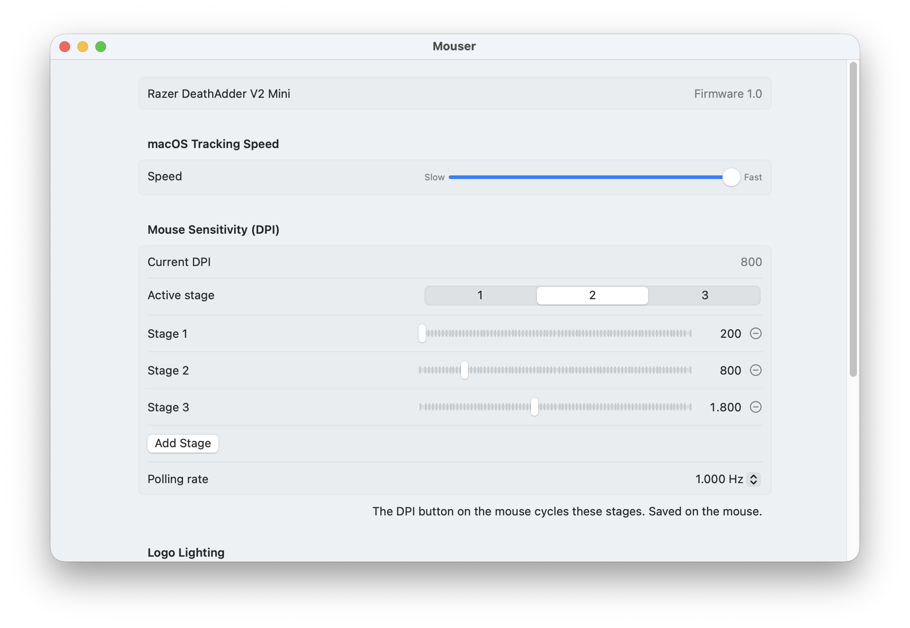

<p align="center">
  
</p>

<p align="center"><b>Native macOS settings app for Razer mice.</b></p>

Razer Synapse doesn't run on macOS. Mouser is a small SwiftUI app that sets your Razer mouse's DPI, polling rate and lighting, and remaps its buttons, all from one window.

- **Hardware settings saved on the mouse.** DPI, DPI stages, polling rate and lighting are written to the mouse's onboard memory. They stay after unplugging or a reboot, or on another computer, even with Mouser closed.
- **Native and lightweight.** Swift + SwiftUI, system frameworks only, no Electron, no background driver, no kernel extension.
- **No special permissions for mouse settings.** Mouser talks to the mouse over plain USB control transfers, so DPI, polling and lighting need no Input Monitoring permission.
- **Button remapping.** Wheel click and the two side buttons can do Back, Forward, Mission Control, DPI up/down or "hold for low DPI".
- **118 mouse models** in the device table, generated from [openrazer](https://github.com/openrazer/openrazer) data.
- **Apple Silicon and Intel**, macOS 14 Sonoma or later.

## Background

Mouser is a spiritual successor to [**razer-macos**](https://github.com/1kc/razer-macos) by 1kc and contributors: an open-source Razer color manager for macOS (Electron + C drivers ported from openrazer) that many Mac users have relied on for years.

Mouser is **not a fork**: no code is copied from razer-macos. It's a new native Swift app that started as a personal "vibe-coded" update of the same idea, written largely with AI assistance, focused only on mice, for current macOS versions. If you need keyboards, mouse mats, headsets or other Razer devices, use razer-macos.

## Features

| Section | What you can do |
|---|---|
| Device | Name, firmware version, battery level and charging state (wireless models) |
| macOS tracking speed | Same setting as System Settings → Mouse, kept in sync both ways |
| Sensitivity | DPI stages (up to 5: add, remove, set DPI, pick the active one) or a single DPI slider; polling rate, including HyperPolling on supported models |
| Lighting | Per zone (logo, scroll wheel, backlight, left/right strips): Off, Static, Breathing, Spectrum, plus brightness |
| Buttons | Remap wheel click, rear and front side buttons |

The window refreshes live: pressing the mouse's own DPI button updates the active stage in the app.

### Button actions

| Action | How it works |
|---|---|
| Default | Button keeps its normal behavior |
| Back / Forward | Presses the front app's own Back/Forward menu item, so it works with any keyboard layout (Safari, Finder, System Settings…) |
| Mission Control | Opens Mission Control |
| DPI stage up / down | Cycles the mouse's DPI stages |
| Hold for low DPI | Lowest stage while held ("sniper" button) |
| Disabled | Button does nothing |

Button remaps are done by Mouser on the Mac, not stored on the mouse. They only work while Mouser is running.

## Download

No signed release yet. Build from source (see [Building](#building)), or download a build from the [Releases](../../releases) page when available.

## Installation

1. Move `Mouser.app` to `/Applications`.
2. Mouser is not notarized, so macOS blocks it on first launch. Open **System Settings → Privacy & Security**, scroll down and click **Open Anyway** next to the Mouser message.
3. *(Only for button remapping)* Click **Allow Accessibility Access…** in Mouser and turn Mouser on under **System Settings → Privacy & Security → Accessibility**.

Why Accessibility: remapping needs to intercept the mouse buttons (event tap) and press menu items in other apps. Mouse settings work without it.

## Device support

Connect the mouse with its USB cable or its USB wireless receiver. **Bluetooth is not supported**: settings are sent over USB.

**Tested on real hardware:**
- Razer DeathAdder V2 Mini: DPI stages, polling rate, logo lighting, brightness, all button actions

**Untested:** every other model below. The data comes from openrazer, but nobody has confirmed it on a Mac with Mouser yet; the app shows a "not tested" note for these. Some special per-model commands aren't implemented and are listed in [`tools/device-report.md`](tools/device-report.md).

If you own one of these mice, please open an issue saying what works and what doesn't. That's the fastest way to move a model to "tested".

<details>
<summary>All 118 models in the device table</summary>

- Razer Abyssus
- Razer Abyssus 1800
- Razer Abyssus 2000
- Razer Abyssus Elite (D.Va Edition)
- Razer Abyssus Essential
- Razer Abyssus V2
- Razer Atheris (Receiver)
- Razer Basilisk
- Razer Basilisk Essential
- Razer Basilisk Mobile (Receiver)
- Razer Basilisk Mobile (Wired)
- Razer Basilisk Ultimate (wired and receiver)
- Razer Basilisk V2
- Razer Basilisk V3
- Razer Basilisk V3 35K
- Razer Basilisk V3 Pro (Wired / Wireless)
- Razer Basilisk V3 Pro 35K (Wired / Wireless)
- Razer Basilisk V3 Pro 35K Phantom Green Edition (Wired / Wireless)
- Razer Basilisk V3 X HyperSpeed
- Razer Basilisk X HyperSpeed
- Razer Cobra
- Razer Cobra HyperSpeed (and Receiver)
- Razer Cobra Pro (Wired / Wireless)
- Razer DeathAdder 1800
- Razer DeathAdder 2000
- Razer DeathAdder 2013
- Razer DeathAdder 3.5G
- Razer DeathAdder 3.5G Black
- Razer DeathAdder 3500
- Razer DeathAdder Chroma
- Razer DeathAdder Elite
- Razer DeathAdder Essential
- Razer DeathAdder Essential (2021)
- Razer DeathAdder Essential (White Edition)
- Razer DeathAdder V2
- Razer DeathAdder V2 Lite
- **Razer DeathAdder V2 Mini** ✅ tested
- Razer DeathAdder V2 Pro (Wired / Wireless)
- Razer DeathAdder V2 X HyperSpeed
- Razer DeathAdder V3
- Razer DeathAdder V3 HyperSpeed (Wired / Wireless)
- Razer DeathAdder V3 Pro (Wired / Wireless)
- Razer DeathAdder V4 Pro (Wired / Wireless)
- Razer Diamondback Chroma
- Razer HyperPolling Wireless Dongle
- Razer Imperator 2012
- Razer Lancehead (Wired / Wireless)
- Razer Lancehead Tournament Edition
- Razer Lancehead Wireless (Receiver / Wired)
- Razer Mamba 2012 (Wired / Wireless)
- Razer Mamba Chroma (Wired / Wireless)
- Razer Mamba Elite
- Razer Mamba Tournament Edition
- Razer Mamba Wireless (Receiver / Wired)
- Razer Naga
- Razer Naga 2012
- Razer Naga 2014
- Razer Naga Chroma
- Razer Naga Epic
- Razer Naga Epic Chroma (Wired / Wireless)
- Razer Naga Hex
- Razer Naga Hex (Red)
- Razer Naga Hex V2
- Razer Naga Left Handed Edition 2020
- Razer Naga Pro (Wired / Wireless)
- Razer Naga Trinity
- Razer Naga V2 HyperSpeed (Receiver)
- Razer Naga V2 Pro (Wired / Wireless)
- Razer Naga X
- Razer Orochi (Wired)
- Razer Orochi 2011
- Razer Orochi 2013
- Razer Orochi V2 (Receiver)
- Razer Orochi V2 (2026) (Receiver)
- Razer Ouroboros
- Razer Pro Click (Receiver / Wired)
- Razer Pro Click Mini (Receiver)
- Razer Pro Click V2 (Wired / Wireless)
- Razer Pro Click V2 Vertical Edition (Wired / Wireless)
- Razer Taipan
- Razer Viper
- Razer Viper 8KHz
- Razer Viper Mini
- Razer Viper Mini SE (Wired / Wireless)
- Razer Viper Ultimate (Wired / Wireless)
- Razer Viper V2 Pro (Wired / Wireless)
- Razer Viper V3 HyperSpeed
- Razer Viper V3 Pro (Wired / Wireless)
- Razer Viper V3 Pro SE (Wired / Wireless)
- Razer Viper V4 Pro (Wired / Wireless)

</details>

## FAQ

**My mouse isn't listed / says "not tested".**
Unlisted mice aren't in openrazer's mouse driver yet. For untested ones, try it and report back in an issue.

**Do I need to keep Mouser running?**
For DPI, polling and lighting: no, they're saved on the mouse. For button remapping: yes.

**Back/Forward does nothing in some app.**
Mouser presses the app's Back/Forward menu item. Apps without one (or with a name Mouser doesn't recognize; English and Italian are supported) can't be driven this way.

**Can I remap the DPI button on top of the mouse?**
No. The mouse firmware handles it and macOS never sees the press.

**I also have razer-macos installed.**
Both apps can write to the mouse; the last one to write wins. Use one at a time.

**Button remapping stopped working after I rebuilt the app.**
Ad-hoc signed builds get a new signature every build, and macOS keeps the old Accessibility grant (switch shows ON but access is denied). Reset it:
```sh
pkill -x Mouser
tccutil reset Accessibility local.mouser.app
open build/Mouser.app
```
Then allow Accessibility again from the app.

## Building

Requirements: macOS 14+, Xcode or Command Line Tools (`xcode-select --install`).

```sh
git clone https://github.com/<your-username>/mouser.git
cd mouser
./build.sh            # → build/Mouser.app (ad-hoc signed)
open build/Mouser.app
```

`build.sh` runs `swift build -c release`, wraps the binary in an app bundle and ad-hoc signs it (`codesign --sign -`).

### Updating the device table

`Sources/Mouser/DeviceTable.swift` is generated; don't edit it by hand. To pull the latest models from openrazer (needs `git` and `python3`):

```sh
tools/update_devices.sh
./build.sh
```

The script clones openrazer into a temp folder, parses the driver and daemon sources, and rewrites `DeviceTable.swift` and `tools/device-report.md`. Commands that need special per-model code are skipped and listed in the report, never guessed.

To mark a model as tested, add its USB product ID to `TESTED` in `tools/generate_devices.py` and regenerate.

### Debug logs

```sh
/usr/bin/log show --last 10m --info --style compact --predicate 'subsystem == "local.mouser.app"'
```

## How it works

- **Detection:** IOHIDManager watches for Razer devices (vendor `0x1532`) being plugged in or out. Devices are only listed, never opened, so no Input Monitoring permission is needed.
- **Transport:** Razer's 90-byte feature reports are sent as USB control transfers on endpoint 0 (`IOUSBDeviceInterface`), like Razer's own tools. Implemented in C in `Sources/RazerUSB`.
- **Protocol:** commands (DPI, stages, polling, battery, four lighting families) are ported from openrazer's `razerchromacommon.c` in `Sources/Mouser/RazerProtocol.swift`. Each model needs the right transaction ID per command: the mouse acknowledges any ID but only executes the correct one. These come from the generated device table.
- **Button remap:** a `CGEventTap` catches wheel click and the two side buttons, and Accessibility (AX) APIs press the front app's menu items. No synthetic keystrokes, so keyboard layouts don't matter.
- **macOS tracking speed:** reads and writes the same `com.apple.mouse.scaling` preference as System Settings and applies it live.

| Path | Role |
|---|---|
| `Sources/RazerUSB/` | C: open device by VID/PID, send/receive 90-byte reports |
| `Sources/Mouser/RazerProtocol.swift` | Razer command implementations |
| `Sources/Mouser/DeviceTable.swift` | Generated per-model data |
| `Sources/Mouser/MouseController.swift` | Detection, state, live refresh |
| `Sources/Mouser/ContentView.swift` | SwiftUI window |
| `Sources/Mouser/ButtonRemapper.swift` | Event tap and button actions |
| `Sources/Mouser/SystemPointer.swift` | macOS tracking speed |
| `tools/` | Device table generator |

## Known limitations

- Only one model tested so far (see [Device support](#device-support)).
- Lighting effects: Off, Static, Breathing, Spectrum. Wave, reactive and custom effects aren't implemented.
- Button remaps apply to these buttons on every connected mouse, not only the Razer one.
- No launch at login yet.
- The DPI slider is capped at 4000 (`dpiCap` in `MouseController.swift`).

## Credits

- [**razer-macos**](https://github.com/1kc/razer-macos): the original open-source Razer app for macOS and the inspiration for this project.
- [**openrazer**](https://github.com/openrazer/openrazer): the Razer protocol and the per-model device data that Mouser's device table is generated from.

Mouser is not affiliated with or endorsed by Razer Inc. "Razer" and product names are trademarks of their respective owners.

## License

[GPL-2.0-or-later](LICENSE), the same license as openrazer, whose device data Mouser uses.
